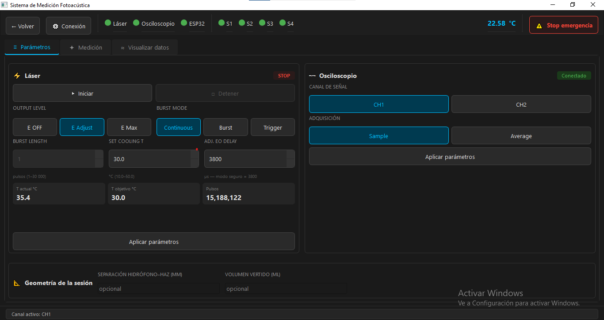

# Automatización de un sistema de medición fotoacústica

Aplicación de escritorio en Python que automatiza un sistema de medición fotoacústica del Instituto de Ciencias Aplicadas y Tecnología (ICAT, UNAM). Es parte de mi tesis de licenciatura en Ingeniería Mecatrónica.

Antes, cada medición se hacía a mano en el osciloscopio. Con esta aplicación, una sola interfaz controla el láser, el osciloscopio y los sensores de temperatura, corre secuencias de medición automáticas y guarda los datos listos para analizarse.



## Qué hace

- **Captura manual o automática.** Mide por intervalo de tiempo fijo o al alcanzar temperaturas objetivo.
- **Control de tres equipos desde una interfaz:**
  - Osciloscopio Tektronix serie TDS5000B, por red (comandos SCPI sobre VXI-11).
  - Láser EKSPLA NL303HT, por RS-232, a través de la DLL del fabricante.
  - ESP32 con 4 sensores DS18B20, por USB serial.
- **Interfaz que no se congela.** Las operaciones lentas (mediciones, lectura de temperatura, reconexión) corren en hilos separados (`QThread`) y se comunican con la interfaz mediante señales de Qt.
- **Reconexión automática.** Si un equipo se desconecta, la aplicación intenta reconectarlo. Si falla un equipo crítico, activa un **modo seguro** que detiene el láser.
- **Registro de datos.** Cada sesión se guarda en una carpeta: un CSV con los metadatos de cada medición y un archivo `.npy` (NumPy) por forma de onda. Las mediciones con fallas parciales no se descartan: se guardan marcadas con un indicador de error y su descripción.
- **Exportación a MATLAB.** Un script convierte una sesión a archivos `.mat`.

## Estructura

```
main.py                    Punto de entrada
app/
  gui/                     Ventanas PySide6 y gráficas (pyqtgraph)
  osciloscopio/            OsciloscopioController: comunicación SCPI/VXI-11
  laser/                   LaserController: registros del láser vía DLL (ctypes)
  temperatura/             TempWorker: lectura continua del ESP32
  medicion/                Orquestación de secuencias automáticas
  almacenamiento/          Sesiones en CSV + .npy
  conexion/                Monitoreo y reconexión de equipos
  modo_seguro/             Apagado seguro del láser
esp32/temperatura/         Firmware del módulo de temperatura
codigos_de_prueba/         Scripts de prueba contra el hardware real
documentos/manual_usuario/ Manual de usuario
```

Cada equipo tiene su propio controlador (una clase), y el acceso al hardware está protegido con un mutex para evitar que dos hilos hablen con el mismo equipo al mismo tiempo.

## Tecnologías

Python · PySide6 · pyqtgraph · NumPy · python-vxi11 · pyserial · ctypes · ESP32 (Arduino) · Git

## Cómo correrlo

Requisitos: Windows (el control del láser depende de una DLL de 64 bits) y Python 3.

```
python -m venv venv
venv\Scripts\pip install -r requirements.txt
venv\Scripts\python.exe main.py
```

También se puede abrir con `iniciar.bat`.

Para conectar los equipos se configuran el puerto del láser, el puerto del ESP32 y la IP del osciloscopio desde el diálogo **Conexión** de la aplicación. El osciloscopio debe tener abierta la aplicación TekScope.

## Limitaciones

- Funciona solo en Windows.
- La mayoría de las pruebas son scripts manuales que requieren el hardware conectado; solo la configuración de usuario tiene una prueba automática sin hardware.
- Pendiente: suite de pruebas con pytest.

## Autor

Evandher Joel Zarco Hernández · [github.com/EvandherZarco](https://github.com/EvandherZarco)
Tesis de licenciatura, Facultad de Ingeniería, UNAM.
